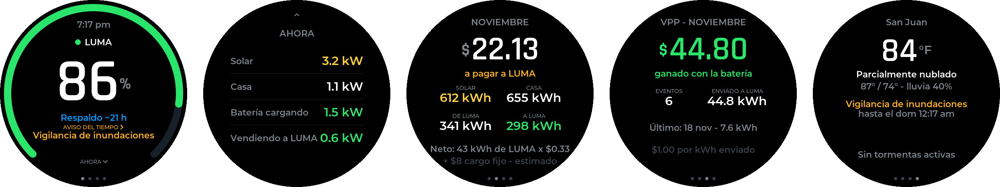

# Home Energy Display (Powerwall · Bill · VPP · Weather)

[](https://www.paypal.com/cgi-bin/webscr?cmd=_xclick&business=jackkorber%40me.com&item_name=%E2%98%95+Coffee+for+HgYperDrive&currency_code=USD&no_note=1)

A round AMOLED desk display for homes in Puerto Rico with a Tesla Powerwall: battery, outages, monthly LUMA bill estimate, VPP earnings and NWS weather alerts. It reads the Powerwall **locally** from the Gateway on your Wi-Fi, so it keeps working during an outage even without internet (as long as your router is on backup power).

*Pantalla redonda para casas en Puerto Rico con Powerwall: batería, apagones, estimado de la factura de LUMA, lo ganado con la VPP y avisos del tiempo. Lee el Powerwall **directo del Gateway** por tu WiFi: sigue funcionando en un apagón aunque no haya internet (si el router está en backup). La pantalla está en español.*

## Screens / Pantallas



*Sample data (demo mode) / datos de ejemplo.*

| | |
|---|---|
| **Energía** | Battery %, grid connected (shows your power company, e.g. **LUMA**) / **APAGÓN**, backup time left, active NWS alert. Swipe up for **Ahora**: live solar, home, battery and grid power. |
| **Mes** | This month's solar, home use, kWh bought from / sold to the power company and the estimated bill or credit. Swipe up/down for past months. |
| **VPP** *(optional)* | Battery-sharing events this month, kWh sent to the grid and $ earned. Swipe up/down for past months. Turn it off with `VPP="no"`. |
| **Tiempo** | Temperature, forecast, NWS alerts (translated to Spanish) and the nearest tropical storm from the NHC. |

Sounds when the power goes out / comes back and for new NWS warnings. At night (10 pm–7 am) the screen turns off unless there is an outage or a serious alert; touch to wake it.

## What you need / Qué necesitas

- **Board:** Waveshare ESP32-S3-Touch-AMOLED-1.75C (466×466 round AMOLED, touch, speaker) — [buy it on Amazon / cómprala en Amazon](https://link.amazon/B08NMlQLx).
- **Powerwall 2 / Powerwall+ with a Backup Gateway 1 or 2.** The **Powerwall 3 does not have this local API**, so it is not supported.
- The Gateway **"customer" password** (the one for `https://<gateway-ip>`). If you never changed it, it is the **last 5 characters of the Gateway serial number**.
- A Mac or Linux computer with `python3` and `curl`. The installer can install [PlatformIO](https://platformio.org/install/cli) for you.

## Install / Instalar

```bash
git clone <this repo>
cd home-energy
./install.sh
```

The script asks for your Wi-Fi, finds the Gateway on your network, **checks the login before flashing**, looks up your town for the weather, writes `src/secrets.h` and flashes the board over USB.

*El script te pide el WiFi, busca el Gateway en tu red, **prueba el login antes de flashear**, busca tu pueblo para el tiempo, escribe `src/secrets.h` y flashea la placa por USB.*

To avoid typing every time, fill in the variables at the top of `install.sh`, or better, put them in a `settings.env` file (git-ignored) so your passwords never end up in a commit:

```bash
WIFI_SSID="MyNetwork"
WIFI_PASS="..."
GW_PASSWORD="..."
TOWN="Ponce"
POWERWALLS="2"
```

> Too many wrong Gateway passwords lock the Gateway for a while. The display backs off for 10 minutes after a failed login.

## Power company and prices / Compañía y precios

Set these at the top of `install.sh` (or in `settings.env`) and run `./install.sh` again whenever they change:

| Setting | Default | Meaning |
|---|---|---|
| `UTILITY_NAME` | `LUMA` | Name shown on screen ("Comprando a LUMA", "a pagar a LUMA"…). Short, plain ASCII. |
| `ENERGY_RATE` | `0.3286` | $ per kWh you buy. |
| `FIXED_CHARGE` | `8` | Fixed monthly charge ($). |
| `SELL_RATE` | *(same as `ENERGY_RATE`)* | $ per kWh you sell. Leave empty for net metering; set it if your company pays less for exports. |
| `VPP` | `yes` | `no` hides the VPP screen and turns off event detection. |
| `VPP_RATE` | `1.00` | $ per kWh your battery sends during a VPP event. |

**LUMA (Puerto Rico):** the price changes **every quarter**. The default is Oct–Dec 2026: **32.86 ¢/kWh + $8 fixed** (the Energy Bureau's 800 kWh model bill of $270.86). With net metering, a month where you sell more than you buy shows as a **credit**: LUMA keeps it on your account, and your bill is never below the fixed charge. The LUMA VPP (*Customer Battery Energy Sharing*) pays about **$1 per kWh** sent during an event.

*Pon tu compañía y precios arriba en `install.sh` (o en `settings.env`) y vuelve a correr `./install.sh` cuando cambien. `VPP="no"` quita la pantalla de VPP.*

## How VPP events are detected / Cómo se detectan los eventos VPP

The Gateway's `grid_services_active` flag is **not reliable**: Home Assistant users report it also turns on while the battery charges from the grid. Instead, the display counts an event when the **battery sends more than 500 W to the grid for 1 minute** (and ends after 3 minutes below 200 W). This works if your exports are set to **solar only** (the usual setting in Puerto Rico), because then the battery never exports outside an event.

## Loading past months / Cargar meses pasados

The board starts counting on the day you install it. You can load earlier months (for example from the Tesla app or Netzero) over USB serial at 115200 baud, one line each:

```
m <solar> <home> <bought> <sold>                         this month so far, kWh
h <YYYYMM> <solar> <home> <bought> <sold> <rate> <fixed>  a past month
v <YYYYMM> <events> <kWh> [<YYYY-MM-DD> <last kWh>]      VPP for a month
```

Test commands: `o` simulate an outage, `a` simulate an alert, `n` force night mode, `d` demo mode with sample data (send again to undo). `p<n>` jumps to a page and `s` sends a screenshot.

Screenshots: `python3 tools/snap.py docs/screens --demo` saves one round PNG per page (needs `pip install pyserial pillow`).

## Privacy / Privacidad

The Powerwall data never leaves your home network. The only internet requests are public weather data: `api.weather.gov` (with your town's coordinates), `api.open-meteo.com` and `nhc.noaa.gov`. Your Wi-Fi and Gateway passwords live only in `src/secrets.h` and on the board.

## Credits / Créditos

Not affiliated with Tesla, LUMA or any power company. Local API knowledge from [pypowerwall](https://github.com/jasonacox/pypowerwall) and [vloschiavo/powerwall2](https://github.com/vloschiavo/powerwall2). Includes [SensorLib](https://github.com/lewisxhe/SensorsLib) (MIT) and Montserrat fonts (SIL OFL). Built with [LVGL](https://lvgl.io).

## ☕ Support / Apoyo

If this display is useful to you, you can [buy me a coffee](https://www.paypal.com/cgi-bin/webscr?cmd=_xclick&business=jackkorber%40me.com&item_name=%E2%98%95+Coffee+for+HgYperDrive&currency_code=USD&no_note=1) — by [HgYperDrive](https://www.youtube.com/@HgYperdrivePR), Tesla FSD from Puerto Rico.

*Si te sirve, puedes [invitarme un café](https://www.paypal.com/cgi-bin/webscr?cmd=_xclick&business=jackkorber%40me.com&item_name=%E2%98%95+Coffee+for+HgYperDrive&currency_code=USD&no_note=1).*
